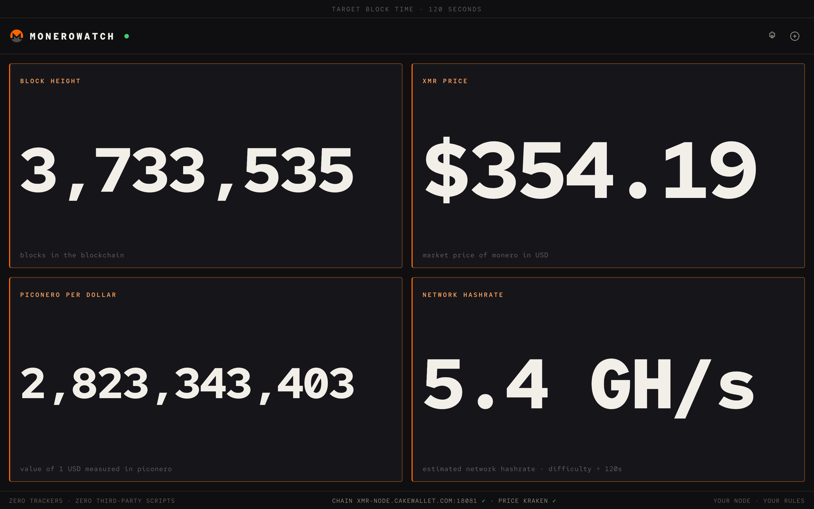
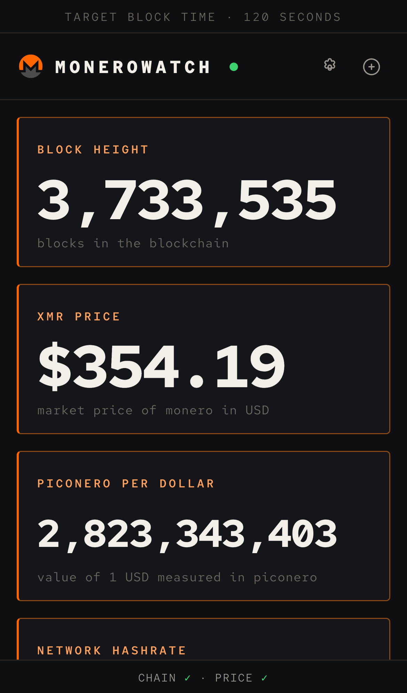

# MoneroWatch

A live Monero network display that runs entirely in the browser. No backend, no trackers, no third-party scripts.



<p align="center">
  
</p>

**[Open MoneroWatch →](https://orangepane.github.io/monerowatch/)** — or clone it and run it yourself (see [Run](#run)).

## What it shows

- Block height, estimated network hashrate, block reward (tail emission), and tx pool size
- XMR price in USD, piconero per dollar, and the XMR/BTC ratio

## Features

- Add, remove, and configure displays; a display can rotate through several stats
- Fullscreen mode per display
- Installable PWA: opens offline and shows last-known values
- Custom monerod node URL in settings. Public nodes see your IP; your own node does not.
- Polls chain data every 10 seconds and price every 30 seconds; pauses when the tab is hidden

## Run

```sh
python3 -m http.server 8000
```

Open http://localhost:8000. Opening `index.html` directly also works, but PWA install needs http(s).

## Data sources

- Chain: monerod JSON-RPC (`get_info`, `get_last_block_header`). Default node is `xmr-node.cakewallet.com:18081`; change it in settings.
- Price: Kraken public API, with CoinGecko and Bitfinex as fallbacks. Every request is time-boxed to 8 seconds.

## Pointing at your own node

monerod rejects browser requests unless you allow this page's origin:

```sh
monerod --rpc-bind-ip 0.0.0.0 --confirm-external-bind \
        --rpc-access-control-origins 'http://localhost:8000'
```

Then set the node URL in settings, e.g. `http://192.168.1.10:18081`.

Two browser rules to know:

- **A plain-`http` node needs a plain-`http` page.** Browsers block `http` requests from an `https` page (mixed content), so a node at `http://192.168.1.10:18081` or `http://127.0.0.1:18081` **will not work on the hosted version** — the request fails silently and the widgets just stop updating. Run MoneroWatch locally for that, or give your node a TLS certificate and use an `https` URL. The default public node is `https`, so the hosted version works out of the box.
- **The origin must match exactly** in `--rpc-access-control-origins` — scheme, host, and port. Use `https://orangepane.github.io` for the hosted version, `http://localhost:8000` for a local one.

## A note on the tx pool

Monero's transaction pool is public — that is what the tx pool widget reads. What Monero hides is amounts, senders, and receivers, not the existence of pending transactions.

The Monero symbol is from the getmonero.org press kit. Fonts are Red Hat Mono (SIL OFL 1.1).
